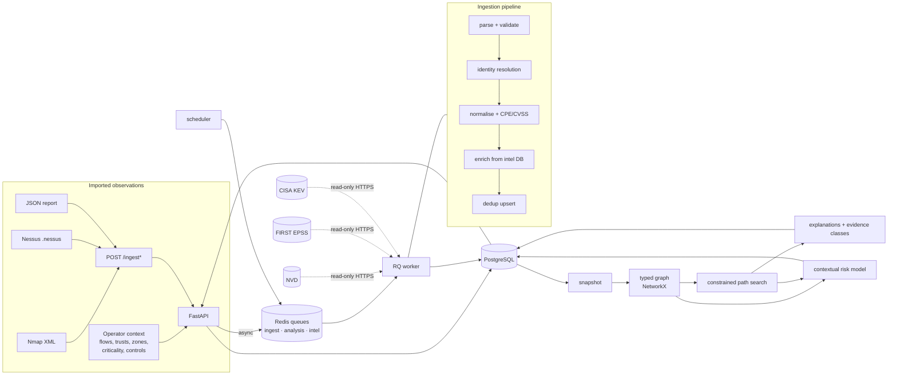

# VulnCorrelator

An evidence-driven vulnerability intelligence and attack-path analysis service. It ingests scanner output, resolves
which *asset* each finding belongs to, enriches findings with attributable threat intelligence, builds a typed
infrastructure graph, and discovers **constrained, explainable attack paths** - always saying how well each link is
evidenced, and never presenting an inference as a confirmed exploit chain.

**Stack:** Python 3.10+ · FastAPI · SQLAlchemy 2 + Alembic · PostgreSQL · Redis (RQ workers, cache, shared rate limits) ·
NetworkX · Docker Compose · pytest

> **Scope.** VulnCorrelator analyses *imported* scanner reports and *explicitly supplied* infrastructure facts. It never
> scans, exploits, or sends payloads anywhere, and its threat-intel clients only read public feeds (CISA KEV, FIRST EPSS, NVD).
> Only use it with data you are authorised to hold.

## What is new in v2 - and what changed incompatibly

v2 moves from "aggregate findings and apply rules" to "model the environment and reason about it from evidence".

| Area | v1 | v2 |
|---|---|---|
| Asset identity | the asset *is* its IP; findings keyed on IP | resolved from MAC / scanner ids / IP / hostname with conflict records and full sighting history |
| Reachability | "same /24 = can talk" | only evidence creates reachability (external scans, observed/declared flows); subnet adjacency is an opt-in, always-*hypothetical* what-if |
| Correlation | three fixed rules | graph search with typed transitions, hop/budget limits, cycle safety, evidence classes, explanations |
| Risk | `CVSS + KEV(1) + EPSS`, additive | independent components (severity, likelihood, exploitability, exposure, controls, business impact, path relevance), versioned config |
| Intelligence | bundled file incl. **invented EPSS values** | NVD + EPSS + KEV sync with retries, rate limits, freshness, history; demo data is opt-in and labelled |
| Security | open unless `API_KEY` set | secure by default, roles, rate limiting, audit log, body/XML/upload limits |

**Breaking changes** (each is deliberate - see git history for the reasoning):

1. **Authentication is required by default.** Set `API_KEY` (or, for local development only, `AUTH_DISABLED=true`). Without either, protected endpoints answer `503`.
2. **`risk_score` is now the v2 prioritisation score** (0-10, see [Risk scoring](#risk-scoring-methodology)); values are not comparable with v1.
3. **`assets.ip_address` is no longer unique** and findings are fingerprinted on the internal asset id. Migration `0002` re-keys every existing finding (verified upgrade *and* downgrade on a v1 SQLite database containing a v1 finding, and round-tripped on PostgreSQL).
4. **`GET /chains` is deprecated** (still works; sends `Deprecation: true`). Its `lateral-movement` rule *assumes* same-subnet reachability, so it is labelled `hypothetical`. Use `/attack-paths`.
5. **No intelligence is invented.** The bundled catalog is *demonstration data*, off by default (`INTEL_DEMO_DATA=true` to enable), and contains no EPSS values at all.
6. **Compose requires secrets** (`API_KEY`, `POSTGRES_PASSWORD`) with no defaults.

## Architecture



The graph is *derived* from the database on each analysis run (a stored, inspectable `AnalysisRun`), so it is always
reproducible from the stored evidence. `app/graph/model.py` hides NetworkX behind a small `GraphView` interface so a
persistent graph backend can be added without touching the algorithms.

## Quick start

```bash
export API_KEY=$(openssl rand -hex 24) POSTGRES_PASSWORD=$(openssl rand -hex 16)
export INTEL_DEMO_DATA=true INTEL_LIVE_SYNC=false      # offline demo: labelled demo catalog, no outbound calls
docker compose up --build       # postgres, redis, api (runs migrations), worker, scheduler
# interactive docs: http://localhost:8000/docs
```

Without Docker (SQLite, no Redis: analysis and ingestion run inline, no caching, no background jobs):

```bash
pip install -r requirements-dev.txt
export AUTH_DISABLED=true                 # local development only
alembic upgrade head && uvicorn app.main:app --reload
```

## Example workflow (real output)

The output below was produced by running exactly these steps against PostgreSQL + Redis with a separate RQ worker
process. `samples/demo_network.json` is a four-host network (all identifiers synthetic): an internet-facing web server
→ app server → database, plus `jump01`, which shares the database's subnet and has a critical flaw but **no evidence
that anything can reach it**.

```bash
H="X-API-Key: $API_KEY"
curl -H "$H" -H 'content-type: application/json' -d @samples/demo_network.json 'localhost:8000/ingest?async_mode=true'   # 202, worker ingests
curl -X PATCH -H "$H" -H 'content-type: application/json' -d '{"criticality":5}' localhost:8000/assets/2                  # db01 is the crown jewel
curl -X POST  -H "$H" -H 'content-type: application/json' -d '{}' localhost:8000/analysis/runs                            # 202, worker analyses
curl -H "$H" localhost:8000/attack-paths
```

```text
paths: 1 | dominated variants pruned: 1
#1 evidence=partially_inferred confidence=0.4 (low) score=2.63 -> 10.10.0.30 (db01.example.test) [3 steps]
   1. initial_access   8.8.4.10 (web01.example.test)    ['CVE-2099-0001'] [inferred]
   2. lateral_movement 10.10.0.20 (app01.example.test)  ['CVE-2099-0002'] [observed]
   3. lateral_movement 10.10.0.30 (db01.example.test)   ['CVE-2099-0004'] [observed]
   missing: reachability of 443/tcp on 8.8.4.10 (web01.example.test) from the internet is inferred from an
            asset-level flag (public_ip); no external scan verified it
```

`jump01` appears on no path. Now an **external-vantage scan** (`samples/demo_external_scan.json`, `"vantage":"external"`)
supplies direct evidence that the port is reachable from the internet. The same MAC address ties it to the existing asset
(matched across two different scanners), and the ingest triggers a fresh analysis automatically:

```text
paths: 1
#1 evidence=observed confidence=0.7 (medium) score=2.73 -> 10.10.0.30 (db01.example.test) [3 steps]
   1. initial_access   8.8.4.10 (web01.example.test)    ['CVE-2099-0001'] [observed]
   ...

CVE-2099-0001  3.53 medium  exposure=internet_observed path=reaches_target likelihood=assumed_missing
CVE-2099-0004  3.13 medium  exposure=internal_flow     path=reaches_target likelihood=assumed_missing
CVE-2099-0005  1.35 low     exposure=unknown           path=not_on_path     likelihood=assumed_missing
```

Note `likelihood=assumed_missing`: no EPSS/KEV data had been synced, so the score says so instead of guessing silently
(and uses a deliberately conservative prior, so missing data never reassures).

### Example attack-path object (abridged)

Produced by `GET /attack-paths` on the same data before the external scan. Steps 1 and 3 of 3 are shown and step
evidence is trimmed; the structure is unchanged.

```json
{
  "path_id": "e8bae29e11298296",
  "confidence": 0.4,
  "confidence_level": "low",
  "evidence_status": "partially_inferred",
  "is_confirmed_exploit_chain": false,
  "entry": {
    "kind": "internet",
    "label": "internet"
  },
  "target_asset": "10.10.0.30 (db01.example.test)",
  "hop_count": 3,
  "priority_score": 2.63,
  "steps": [
    {
      "order": 1,
      "action": "initial_access",
      "asset_id": 4,
      "asset": "8.8.4.10 (web01.example.test)",
      "service": {
        "port": 443,
        "protocol": "tcp",
        "product": "Acme WebServer"
      },
      "vulnerabilities": [
        {
          "cve_id": "CVE-2099-0001",
          "cvss_score": 9.8
        }
      ],
      "confidence": 0.4,
      "evidence_status": "inferred",
      "evidence": [
        {
          "edge_type": "CONNECTS_TO",
          "evidence_status": "inferred",
          "source": "asset_flag:public_ip"
        },
        {
          "edge_type": "AFFECTED_BY",
          "evidence_status": "observed",
          "source": "demo-scanner"
        },
        {
          "edge_type": "CAN_EXPLOIT",
          "evidence_status": "observed",
          "source": "demo-scanner"
        }
      ]
    },
    "... step 2 (lateral_movement) omitted ...",
    {
      "order": 3,
      "action": "lateral_movement",
      "asset_id": 2,
      "asset": "10.10.0.30 (db01.example.test)",
      "service": {
        "port": 5432,
        "protocol": "tcp",
        "product": "Acme Database"
      },
      "vulnerabilities": [
        {
          "cve_id": "CVE-2099-0004",
          "cvss_score": 9.8
        }
      ],
      "confidence": 0.7,
      "evidence_status": "observed",
      "evidence": [
        {
          "edge_type": "CONNECTS_TO",
          "evidence_status": "observed",
          "source": "report:demo-scanner"
        },
        {
          "edge_type": "AFFECTED_BY",
          "evidence_status": "observed",
          "source": "demo-scanner"
        },
        {
          "edge_type": "CAN_EXPLOIT",
          "evidence_status": "observed",
          "source": "demo-scanner"
        }
      ]
    }
  ],
  "assumptions": [
    "the attacker starts on the internet with no prior access"
  ],
  "missing_evidence": [
    "reachability of 443/tcp on 8.8.4.10 (web01.example.test) from the internet is inferred from an asset-level flag (public_ip); no external scan verified it"
  ],
  "risk_factors": [
    {
      "factor": "target_criticality",
      "value": 5.0,
      "detail": "10.10.0.30 (db01.example.test) (business-impact factor 1.0)"
    },
    {
      "factor": "step_exploitability",
      "value": 0.324,
      "detail": "geometric mean of each step's threat (exploitation likelihood x attackability); credential/trust steps use a fixed factor"
    },
    {
      "factor": "path_length",
      "value": 3.0,
      "detail": "x0.81 for 3 steps (decay 0.9 per extra step)"
    },
    {
      "factor": "evidence_class",
      "value": "partially_inferred",
      "detail": "reported separately from the score: a high-scoring path can still be weakly evidenced"
    }
  ],
  "potential_impact": {
    "target_asset_id": 2,
    "target_asset": "10.10.0.30 (db01.example.test)",
    "target_criticality": 5,
    "privilege_gained": "user",
    "summary": "user-level compromise of 10.10.0.30 (db01.example.test) (criticality 5/5)"
  },
  "summary": "Partially inferred attack path: internet -> 10.10.0.30 (db01.example.test) in 3 step(s)",
  "confidence_semantics": "ordinal_uncalibrated"
}
```

## Graph data model

**Node types:** `host` · `interface` · `service` · `vulnerability` · `identity` (credential) · `privilege` (user/admin on a host) · `boundary` (the internet, or a declared zone)

| Edge | Meaning | Created from |
|---|---|---|
| `HOSTS` | host → interface; zone → host | scan sightings; declared zone CIDRs |
| `RUNS_SERVICE` | host → open port | scanner reports |
| `AFFECTED_BY` | service (or host) → vulnerability | scanner findings, version matches |
| `CONNECTS_TO` | internet / compromised host → service | external scans, observed or declared flows, asset-level exposure flag |
| `CAN_EXPLOIT` | vulnerability → privilege gained | remotely exploitable flaw whose CVSS vector says `AV:N` and whose impact grants code execution |
| `CAN_ESCALATE_TO` | user → admin on one host | local privilege-escalation flaw |
| `AUTHENTICATES_TO` | identity → service | declared credential validity |
| `CAN_ACCESS` | privilege → identity (credential obtainable); service → privilege (login) | declared |
| `SHARES_TRUST_WITH` | privilege on A → privilege on B | declared trust |

Every non-definitional edge carries `evidence_status`, an ordinal `confidence`, the evidence `source`, `first_seen` /
`last_seen`, and the underlying `evidence` records (inspect with `GET /graph/edges/{id}`).

## Evidence classification

| Class | Meaning | Examples in this system |
|---|---|---|
| **confirmed** | verified by active validation | a scanner that actually exploited the flaw (Nessus `exploited_by_nessus`, JSON `"verified": true`); relationships an operator attests as `confirmed` |
| **observed** | directly reported or seen | scanner findings and open ports; a port seen open from an **external** vantage; observed `connections`; operator-declared flows (the operator attests them) |
| **inferred** | derived by the system from observed facts | a vulnerable *version* matched via CPE/NVD or the demo catalog; an asset-level "internet-facing" flag (public IP / declaration) with no port-level evidence; impact classified from tags when no CVSS vector exists |
| **hypothetical** | an assumption | same-subnet reachability (opt-in); an analyst-supplied foothold; flows an operator marks hypothetical |

A **path's** class is its *weakest link*: `hypothetical` if any link is, else `partially_inferred` if any is inferred,
else `confirmed` only if **every** link is confirmed, else `observed`. `is_confirmed_exploit_chain` is true only for
`confirmed`. **Confidence is an ordinal ranking (confirmed 0.9 > observed 0.7 > inferred 0.4 > hypothetical 0.15),
the minimum over the path - it is not a probability and has not been calibrated.** Every response says so
(`"confidence_semantics": "ordinal_uncalibrated"`).

## Attack-path discovery

The attacker occupies a *position*: the internet, or a privilege level (user/admin) on a host. A path is a sequence of
*transitions*:

| Transition | Requires |
|---|---|
| exploit | `CONNECTS_TO` evidence to a service, plus a remotely exploitable flaw on it |
| escalate | user on the host + a local escalation flaw |
| credential | admin/user on a host that exposes a credential + a service that credential logs in to **and that is reachable from a position already held** |
| trust | the declared privilege on the trusting host |

Constraints: `max_steps` (default 5) · no position visited twice (**cycle-safe**; cycles are *reported* as mutually
reachable host clusters in run stats) · hypothetical edges ignored unless `include_hypothetical` · a hard work budget
(`PATH_MAX_EXPANSIONS`, results flagged `truncated`) · a path ends at its first target (criticality ≥ 4, or any admin
state if none are designated, or `target_asset_ids`). Alternative exploits for one step are collapsed (the best by
threat is selected; the rest are listed). **Dominated paths are pruned**: a path is dropped only if a shorter path
through a subset of its steps reaches the same target with at-least-as-strong evidence, so a longer but
better-evidenced route survives.

Each path reports: entry, target, steps (asset, service, CVEs, prerequisites derived from the CVSS vector, per-edge
evidence), `assumptions`, `missing_evidence`, `risk_factors`, `potential_impact`, `boundaries_crossed`, `confidence`,
`evidence_status`. `priority_score = 10 × target criticality factor × geometric-mean(step threat) × 0.9^(steps-1)`.

## Risk scoring methodology

Model `contextual-v2` (`GET /risk/model` returns the live parameters and a config hash; override with `RISK_MODEL_CONFIG_PATH`):

```
likelihood     = max(KEV floor, if on CISA KEV ; EPSS)        # missing EPSS -> flagged prior 0.2, never silent
exploitability = CVSS v3 exploitability sub-score / max        # from the vector; else flagged prior 0.5
exposure       = strongest reachability evidence: internet_observed 1.0 · internet_inferred 0.8 ·
                 internal_flow 0.5 · local_only 0.3 · unknown 0.3
controls       = product of multipliers for declared controls (assumed, not measured)
attackability  = exposure × exploitability × controls
threat         = sqrt(likelihood × attackability)
impact         = 0.5 × CVSS/10 + 0.5 × asset-criticality factor (1..5 → 0.2..1.0)
relevance      = reaches_target 1.0 · on_attack_path 0.85 · not_on_path 0.7
priority       = 10 × impact × threat × relevance            bands: ≥7.5 critical · ≥5 high · ≥2.5 medium
```

Every finding stores its components (`risk_components`) and `data_quality` notes for anything assumed. **The score ranks
remediation work. It is not a probability of compromise and has not been calibrated against incident data.**
What-if analysis runs never overwrite stored scores.

## Threat intelligence

| Source | Used for | Notes |
|---|---|---|
| NVD CVE API 2.0 | CVSS, description, CWE, CPE configurations; `cpeName` lookups map a discovered *product version* to CVEs | results are re-verified against NVD's own `cpeMatch` ranges before being trusted |
| FIRST EPSS | exploitation probability | tracked CVEs only, 100 per request |
| CISA KEV | known-exploited flag | conditional GET (ETag); an empty/corrupt feed never wipes the catalog |

Resilience: per-request timeout, bounded retries with exponential back-off + jitter, `Retry-After` honoured (capped),
client-side limiter inside NVD's published limits (5 requests/30 s, 50 with `NVD_API_KEY`), per-run request budgets,
upstream outages recorded as failed runs that leave existing data untouched. Ingestion itself **never** touches the
network; enrichment runs on the `intel` queue (after ingests, and on a schedule: `python -m app.intel.scheduler`, or
`python -m app.intel.cli sync` from cron without Redis).

**Data classes** (`GET /intel/status`, `GET /intel/cves/{id}`): `live` (fetched, within its freshness window) ·
`cached` (older than its window: shown, flagged stale) · `demo` (bundled, labelled) · `missing` (nothing is
substituted). Every changed EPSS/CVSS/KEV value is appended to an **immutable history**.

## Asset identity

Resolution order: scanner-assigned id → MAC (shared VRRP/HSRP MACs and multicast are ignored) → same IP → unique FQDN →
new asset. Two hosts are **never merged** when strong identifiers disagree or hostnames clearly differ; each refusal is
stored (`GET /identity/conflicts`) and each sighting is kept (`GET /assets/{id}/observations`). Creation is serialised with
PostgreSQL advisory locks (verified with 8 concurrent writers → exactly one asset), findings are deduplicated by a unique
fingerprint over the asset id, and each host is ingested in its own idempotent transaction.

## API

All endpoints except `/health` need `X-API-Key`; `reader` keys may only `GET`. Lists are paginated; see `/docs` for schemas.

| Area | Endpoints |
|---|---|
| Ingest | `POST /ingest` · `POST /ingest/upload` (Nmap XML / Nessus, optional `vantage`, `async_mode`) · `GET /reports[/{id}]` |
| Assets | `GET /assets[/{id}]` · `PATCH /assets/{id}` (exposure, criticality, tags, controls) · `/services` · `/vulnerabilities` · `/observations` · `/relationships` |
| Findings & risk | `GET /vulnerabilities[/{id}]` · `GET /risk/priorities` · `GET /risk/model` |
| Graph | `GET /graph` (center, depth, type/confidence filters, node cap) · `GET /graph/edges/{id}` (evidence inspection) |
| Attack paths | `POST /analysis/runs` · `GET /analysis/runs[/{id}]` · `GET /analysis/status` (staleness) · `GET /attack-paths` (score/confidence/evidence/asset/CVE filters) · `GET /attack-paths/{id}` |
| Network context | `POST/GET/DELETE /network/relationships` (flows, credentials, trusts) · `POST/GET/DELETE /network/boundaries` · `GET /identity/conflicts` |
| Intelligence | `GET /intel/status` · `GET /intel/cves/{id}` · `GET /intel/sync-runs` · `POST /intel/sync` |
| Operations | `GET /health` · `GET /audit` (admin) · `GET /stats` · deprecated: `GET /chains[/{id}]` |

## Configuration

| Variable | Default | Purpose |
|---|---|---|
| `API_KEY` / `READONLY_API_KEY` | - | admin / read-only keys (also read from `/run/secrets`) |
| `AUTH_DISABLED` | `false` | explicit local-development opt-out |
| `DATABASE_URL` | SQLite file | use `postgresql://…` in production |
| `REDIS_URL` | unset | queues, shared rate limits, cache |
| `INTEL_LIVE_SYNC` / `INTEL_DEMO_DATA` | `true` / `false` | air-gap switch / labelled demo catalog |
| `NVD_API_KEY` | unset | raises NVD's rate limit |
| `KEV_TTL_HOURS` `EPSS_TTL_HOURS` `NVD_TTL_HOURS` `INTEL_SYNC_INTERVAL_HOURS` | 48 · 48 · 168 · 24 | freshness windows / schedule |
| `MAX_UPLOAD_MB` `MAX_REQUEST_BODY_MB` `MAX_FINDINGS_PER_HOST` `MAX_XML_ELEMENTS` | 20 · 25 · 5000 · 3,000,000 | resource-exhaustion limits |
| `RATE_LIMIT_{DEFAULT,INGEST,ANALYSIS}_PER_MIN` | 240 · 20 · 12 | per-key limits (Redis-backed when available) |
| `INLINE_ANALYSIS_MAX_ASSETS` `PATH_MAX_EXPANSIONS` `STALE_EVIDENCE_DAYS` | 300 · 200000 · 30 | analysis behaviour |
| `RISK_MODEL_CONFIG_PATH` | unset | JSON overrides for the scoring parameters |

## Security notes

Constant-time key comparison with brute-force lockout · roles · per-key rate limits (Redis-backed) · audit log of
mutations and denials (actors are key fingerprints; secrets are never stored) · `defusedxml` with entity/external
references refused and only a bare `<!DOCTYPE name>` allowed · XML element-count, upload-size and body-size limits ·
strict Pydantic validation everywhere · error responses never leak internals (request-id correlated) · non-root container
· no hard-coded credentials (compose refuses to start without secrets) · stuck-job recovery and bounded retries.

## Testing and evaluation

```bash
pip install -r requirements-dev.txt
pytest -q                                                    # SQLite (fast)
TEST_DATABASE_URL=postgresql://u:p@localhost/vulntest \
TEST_REDIS_URL=redis://localhost:6379/5 pytest -q            # PostgreSQL + a REAL Redis/RQ worker
ruff check . && alembic upgrade head && alembic check        # lint + migrations match the models
python -m evaluation.run                                     # the evaluation below (about 10 s)
```

Measured test results at the time of writing: ****267 passed** on SQLite (5 skipped: the PostgreSQL concurrency test and the 4 real-Redis tests, which need those services) and **272 passed** on PostgreSQL 16 with a real Redis 7 + RQ worker**.

### Evaluation (measured; reproduce with `python -m evaluation.run`)

Synthetic networks with **known** attack paths: chains are planted by construction (exploit chains, escalate-then-trust,
credential reuse) and surrounded by decoys that cannot be compromised (same-subnet hosts with no flow, local-only flaws,
dead-end services, hypothetical-only links, flows to closed ports). A separate **independent oracle** - written from the raw
data, sharing no code with the engine - checks randomized networks and re-validates every step of every reported path.

| Suite | Result |
|---|---|
| **Planted ground truth** (30 scenarios, 225 true paths, 720 decoy hosts) | path precision **1.0**, recall **1.0** (tp 225 / fp 0 / fn 0); false-negative rate 0.0; decoy false-positive rate **0.0** (0/720 decoys on any path) |
| Evidence classes | class accuracy 1.0; evidence **overstated: 0** (a path reported stronger than its weakest link would allow) |
| Graph construction | 4505 edges across 30 scenarios vs an independently derived edge set: mean Jaccard 1.0 (min 1.0) |
| **Independent oracle** (240 random networks, 3 densities, 30-60 hosts) | reachable-target precision 1.0, recall 1.0 (tp 547 / fp 0 / fn 0); **1598 reported paths re-validated step by step: 0 invalid** (906 with ≥3 hops, 256 using escalation or trust) |
| **Legacy `/24` rule engine** on the same planted truth | precision **0.4417**, recall **0.32** (vs 1.0 / 1.0 for the attack-path engine); it invents paths into unreachable same-subnet hosts and cannot see chains longer than two hops |

| hosts | graph nodes | graph edges | paths | build (s) | search (s) | explain (s) | total (s) | peak heap (MB) |
|---:|---:|---:|---:|---:|---:|---:|---:|---:|
| 50 (sparse) | 364 | 443 | 3 | 0.0034 | 0.0005 | 0.0001 | **0.0041** | 0.9 |
| 100 (sparse) | 757 | 933 | 5 | 0.0073 | 0.0009 | 0.0003 | **0.0085** | 1.9 |
| 200 (sparse) | 1474 | 1785 | 5 | 0.0152 | 0.0019 | 0.0003 | **0.0174** | 3.8 |
| 400 (sparse) | 2936 | 3574 | 8 | 0.062 | 0.0039 | 0.0005 | **0.0664** | 7.6 |
| 800 (sparse) | 5877 | 7146 | 18 | 0.1159 | 0.0088 | 0.0011 | **0.1255** | 15.1 |
| 50 (dense) | 414 | 652 | 15 | 0.0076 | 0.0113 | 0.001 | **0.02** | 1.3 |
| 100 (dense) | 866 | 1348 | 43 | 0.0159 | 0.0183 | 0.0039 | **0.0387** | 3.0 |
| 200 (dense) | 1761 | 2664 | 48 | 0.03 | 0.0354 | 0.0045 | **0.0701** | 5.5 |
| 400 (dense) | 3460 | 5304 | 109 | 0.0785 | 0.0466 | 0.009 | **0.1341** | 11.2 |


How to read this honestly:

* These scores say the engine **implements its documented model correctly** (every reported path valid; none missed or
  invented relative to an independent restatement of the model). They say nothing about how well the model matches a real
  network - firewall rules, banner lies, backported fixes and unreported hosts are outside the ground truth.
* The tests contain **mutation tests**: deliberately breaking the engine (trusting hypothetical links, assuming
  same-subnet reachability, overstating evidence, dropping credential pivots, ignoring attack vectors, dropping graph
  edges) must make the harness fail, otherwise a perfect score would mean nothing.
* The legacy comparison scores the old `/24` rules against the *evidence-based* ground truth; it is a statement about
  that rule's assumption, not about scanners.
* Timings: wall-clock medians of 3 runs on a 1-core x86_64 Linux sandbox (Python 3.12.3), graph build + search (≤4 steps, ≤500 paths) + explanation, excluding
  database I/O. Memory is the peak *Python-heap* from `tracemalloc` (not process RSS; whole-process peak RSS was 106.3 MB).
  Synthetic networks are not a benchmark of any real estate.

## Known limitations

* **Evaluation is synthetic** (see above). No real-world accuracy figure exists, and none is claimed.
* **Threat-intel clients were tested against mocked HTTP only** (the development sandbox has no outbound access). Endpoint
  URLs and field names follow the public documentation; watch `GET /intel/status` after the first live sync.
* **Parsers were tested on hand-written fixtures** modelled on the documented Nmap/Nessus formats, not a corpus of real exports.
* **Reachability comes only from declared or observed facts.** There is no firewall-rule, routing or flow-log ingestion
  beyond the JSON `connections` field and the relationship API; unknown reachability yields *no* path, so the tool can
  under-report. That is the deliberate trade-off against inventing paths.
* **Risk weights are policy, not measurements.** Control multipliers are assumed; declared controls are *listed* on paths but do not change path feasibility.
* **Identity resolution is conservative**: a multi-homed host with no shared identifier appears as two assets until it is
  seen with a shared MAC/scanner id (there is no manual merge endpoint; conflicts are listed for review).
* **Single tenant.** Two roles, static API keys; no tenant isolation, SSO or key rotation. The rate limiter keys on the API key and the direct client address (it does not trust `X-Forwarded-For`).
* **The audit log lives in the application database** (not tamper-evident).
* The graph is rebuilt in memory per analysis run; very large estates need the persistent backend the interface was designed for.
* Verified here: Python 3.12, PostgreSQL 16, Redis 7 on Linux. CI also targets Python 3.10/3.11 and a `docker compose` smoke test, which could **not** be run in the development sandbox.
* The v1→v2 migration was verified up and down on a v1 database and round-tripped on PostgreSQL, but not on large production data - back up first.

## Roadmap

Persistent graph backend (Neo4j) behind `GraphView` · firewall/flow-log and cloud-security-group importers · Trivy/OpenVAS
parsers · manual identity merge · tenant isolation and SSO · calibration of the risk model against incident data ·
notifications (Slack/Jira) and a dashboard over the existing API.
